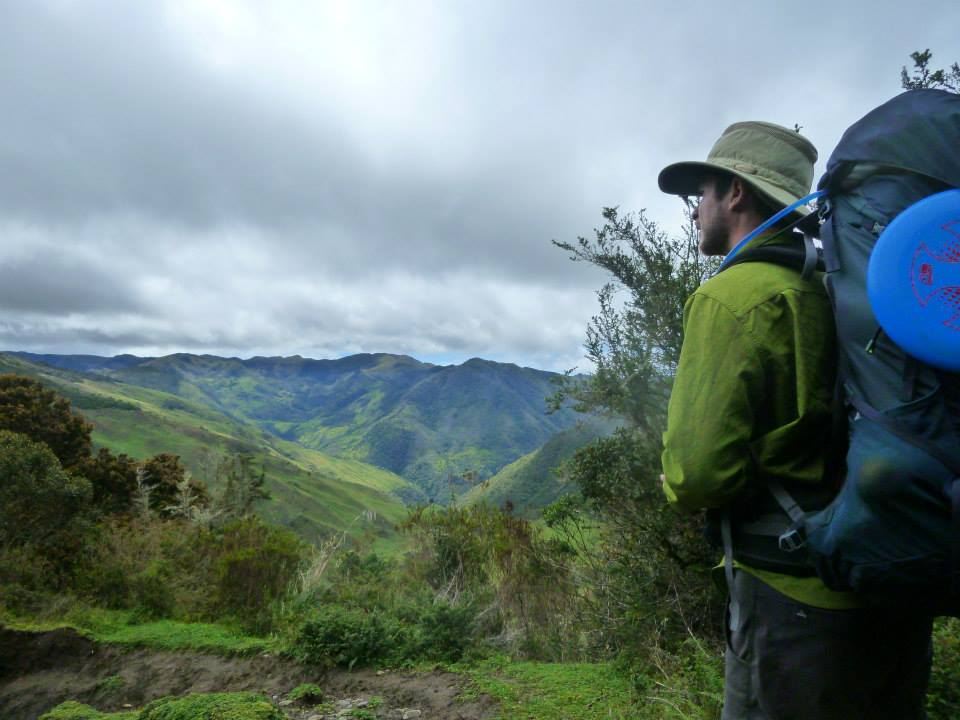

A little about me

<h1>Curiosity, from the landscape to the data.</h1>

<figure class="landscape-photo"><figcaption>Cordillera Central / A view from the field</figcaption></figure>

I am currently a research fellow with the [iNEST program](https://www.consorzioinest.it/en/) at the University of Venice Ca' Foscari. I am also hosted at the RiverLy research unit at [INRAe](https://riverly.inrae.fr/en/home) with the [EcoFlows team](https://ecoflows.inrae.fr/)
in Lyon, France. I am working with [Enrico Bertuzzo](https://scholar.google.it/citations?user=J0y5sPoAAAAJ&hl=it&inst=13410158990364976897)
to study the carbon budgets of river networks.

We are currently focused on three major themes: 

1) How much carbon in rivers comes from the landscape and how much comes from [stream and river metabolism](https://en.wikipedia.org/wiki/Stream_metabolism)? 

2) How does this amount of carbon in rivers vary across space and time?

3) How does river network structure, like the number of confluences and their orientation,
influence the availability of carbon in river networks?

These themes advance our understanding of how rivers and river networks link aquatic and terrestrial carbon cycles,
and further grow our knowledge of the relative role of biologic versus physical controls on the carbon cycle. 

[View my CV (PDF)](docs/CV.pdf){.primary-link}

