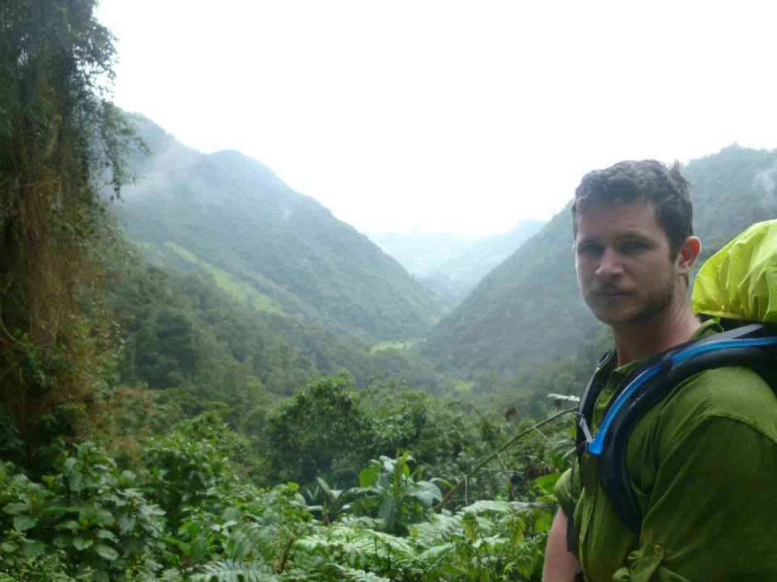
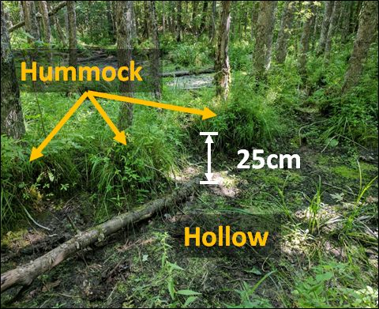
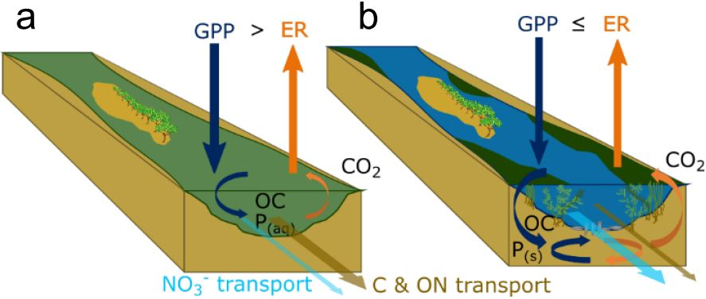

jakediamond.science

<h1>Jake Diamond</h1>

Greetings!

Hope you are well reading this. My name is Jake and I work on water quality and ecohydrology.

I am now a <strong>Programme Specialist for Water Quality and Ecohydrology at UNESCO</strong>, in Paris.

My background is in environmental data science, hydrology, ecosystem ecology, and biogeochemistry. This website has some of my research, figures, and publications.

<a href="about.html">More about me</a> · <a href="mailto:diamondjacob@gmail.com">Get in touch</a>

<figure class="home-photo"><figcaption>Cordillera Central</figcaption></figure>

<section class="research-sampler" aria-labelledby="research-heading">

<h2 id="research-heading">Research</h2><a href="research.html">All research &amp; papers →</a>

I'm interested in questions like:

<ol class="questions">
<li>How do ecosystems <a href="research.html#anchormicro">self-organize</a>?</li>
<li>What can emergent properties of ecosystems tell us about their <a href="research.html#anchorbgc">internal processes</a>?</li>
<li>How can we use our understanding of ecosystems to improve <a href="research.html#anchorriveco">resource management and human health</a>?</li>
</ol>

<figure><a href="research.html#anchormicro">Wetland microtopography</a><figcaption>Plants, water, and the shape of the ground.</figcaption></figure>
<figure><a href="research.html#anchorriveco">River ecology</a><figcaption>Nutrients, algae, and changes in the Loire.</figcaption></figure>
<figure><a href="research.html#headwater-stream-biogeochemistry">Headwater streams</a><figcaption>Dissolved oxygen, drying, and warming.</figcaption></figure>

</section>

<section class="home-contact"><h2>Contact</h2>
<a href="mailto:diamondjacob@gmail.com">diamondjacob@gmail.com</a>

Thank you for visiting!
</section>
